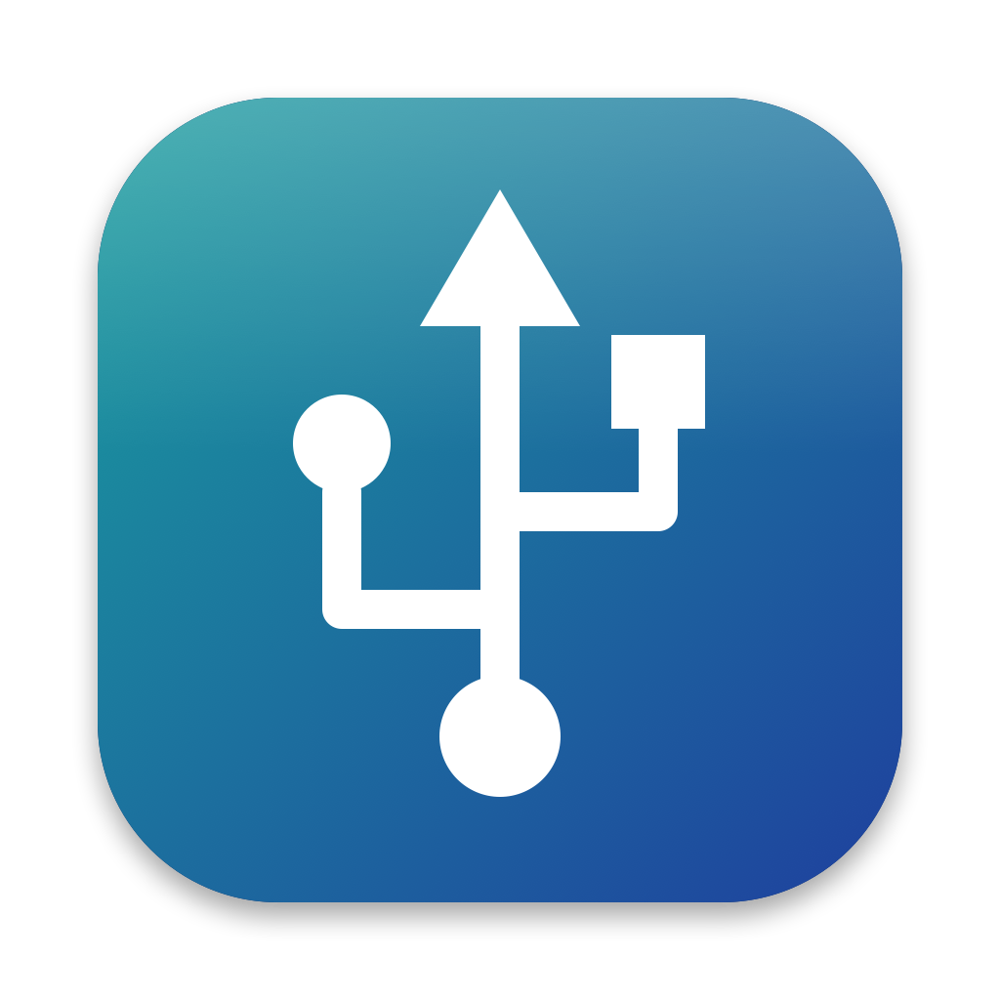
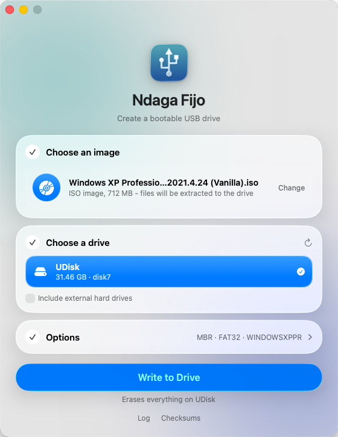
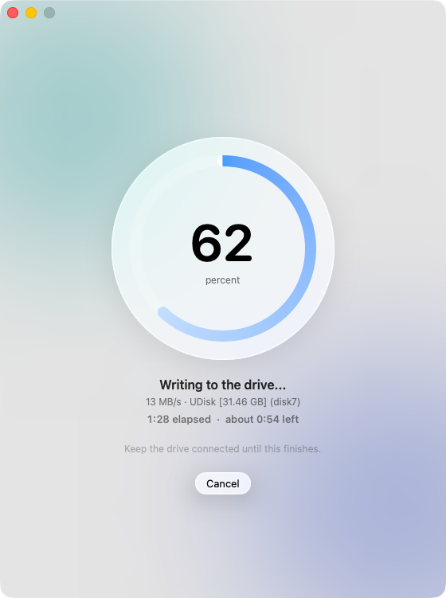
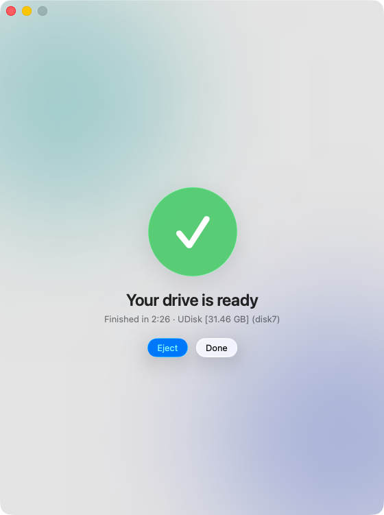

# Ndaga Fijo

A native macOS (SwiftUI) bootable-USB creator, based on [Rufus](https://rufus.ie) and following its workflow: pick a removable drive, pick an ISO/IMG,
choose the format options, and write. The Windows sources in `../src` are untouched.

  
  
  

Website: https://festomanolo.com/ndaga-fijo/ · Install: `pip install ndaga-fijo` · [Releases](https://github.com/festomanolo/ndaga-fijo/releases)

## Build and run

    ./build-app.sh && open build/NdagaFijo.app

Requires Xcode command line tools (Swift 5.9+), macOS 13+.

## How it works

* **Drives:** only whole removable physical disks are listed (fixed external drives need "List USB hard drives"); disks backing the running system, including the APFS physical store, are always refused.
  The privileged helper re-checks this before touching anything.
* **DD mode** (hybrid ISOs and raw images): block-for-block write to `/dev/rdiskN`, optional read-back verify.
* **ISO mode** (plain ISOs): drive is erased as MBR or GPT with FAT32 or ExFAT, then the ISO contents are copied.
  Windows ISOs work: an `install.wim` over 4 GB is split into `install.swm`, `install2.swm`... (compressed data is copied
  untouched, only headers are rewritten), which Windows Setup reads natively. With MBR + FAT32 and a `bootmgr` on the image,
  the Windows 7 MBR and FAT32 NT boot record (from `src/ms-sys`) are installed so legacy BIOS can boot too. Other extracted
  ISOs boot via UEFI only.
* **Speed:** copying thousands of files through the macOS FAT driver onto a USB stick is dominated by slow per-file
  metadata writes (34 min for the 6,959-file Windows XP ISO in our test, against 67 s for a raw write of the same bytes).
  For FAT32, Ndaga Fijo formats the stick, clones its FAT geometry into a sparse image on the Mac's SSD, copies the files
  there, repairs the image with `fsck_msdos`, and streams the used part to the stick in one sequential pass using 8 MB
  buffers with the read overlapped with the write. Measured end to end on that stick: **2 min 26 s** (6 s scan, 10 s format,
  37 s stage, 21 s flush and repair, 58 s stream). Findings worth knowing: more copy threads did not speed up staging
  (1, 4 and 8 threads all took about the same, since the macOS FAT driver serializes metadata), so the win comes from
  moving the metadata work off the stick, not from parallel writes. Set `NDAGA_NO_STAGING=1` to force the direct copy path.
  ExFAT still uses the direct path. The write shows a live MB/s figure and a time-remaining estimate from the measured rate.
* Not yet verified: booting on real hardware (UEFI and BIOS), the admin-prompt path end to end, and writes to real USB drives.
* Writing needs root: the app asks for your password once per job (standard macOS prompt) and runs only its
  own small helper mode (`NdagaFijo --helper`) as root.
* Checksums: MD5, SHA-1, SHA-256, SHA-512.

## Not ported (Windows-only or not feasible)

Windows To Go, Windows install customization (OOBE/TPM bypass), NTFS/ReFS/UDF formatting, UEFI:NTFS, syslinux BIOS boot for non-hybrid Linux ISOs,
bad-block checks, FreeDOS/MS-DOS, VHD/FFU images, persistent Linux partitions, Microsoft ISO downloader,
compressed image support, localization.

## Testing safely

Set `NDAGA_ALLOW_DISK_IMAGES=1` to also list `hdiutil attach -nomount` disk images, and test against those:

    hdiutil create -size 64m -layout NONE test.dmg && hdiutil attach -nomount test.dmg
    NDAGA_ALLOW_DISK_IMAGES=1 open build/NdagaFijo.app

## Credits and license

Ndaga Fijo is a derivative work of [Rufus](https://github.com/pbatard/rufus) by Pete Batard and contributors, and of
ms-sys (boot code in `Sources/NdagaFijo/BootCode.swift`). It is licensed under the GNU GPL v3 or later, see
`../LICENSE.txt`. "Rufus" is the name of the original project; Ndaga Fijo is not affiliated with or endorsed by it.
